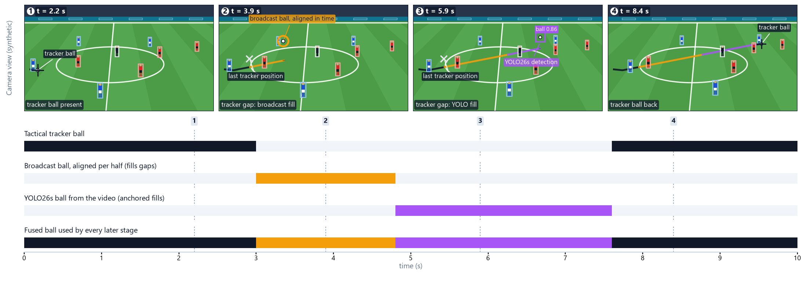
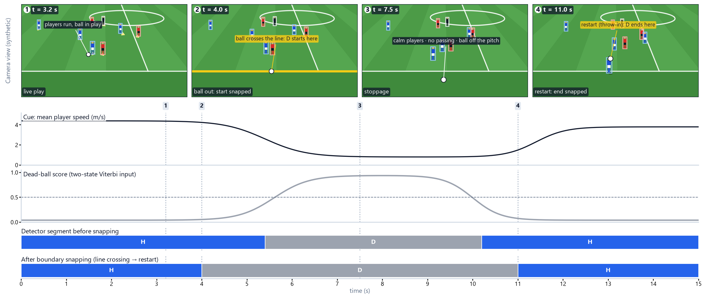
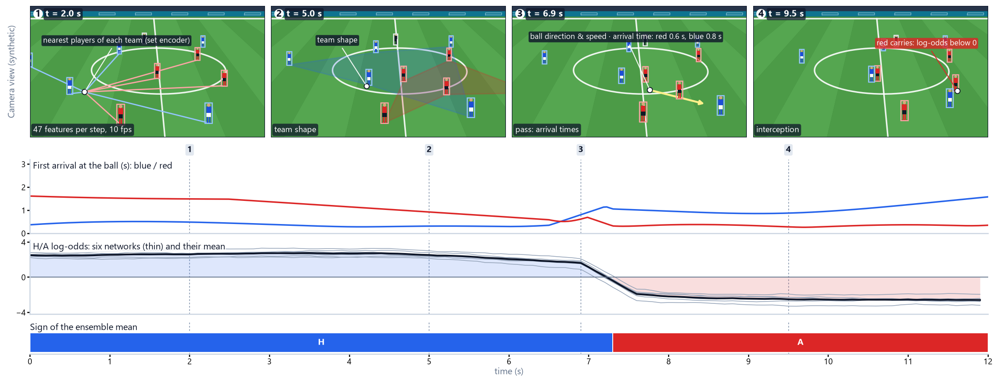
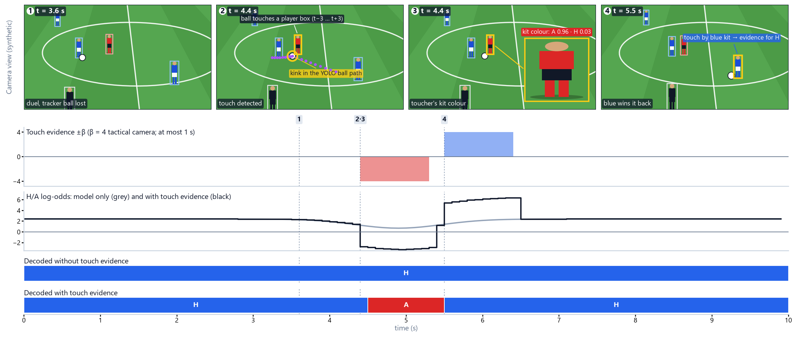
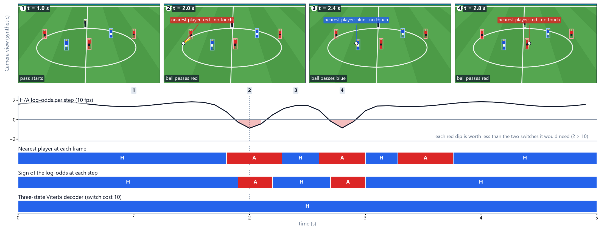
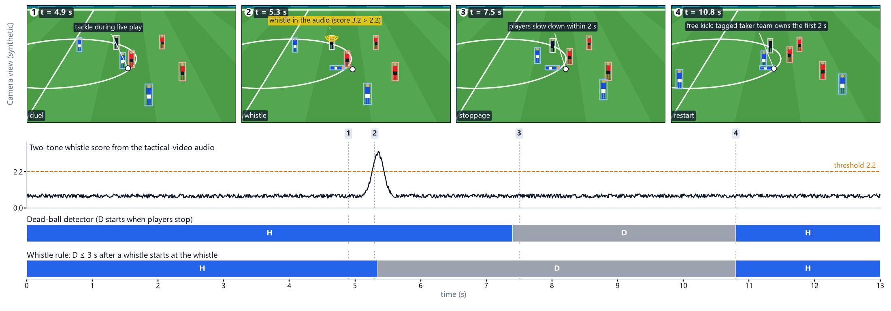
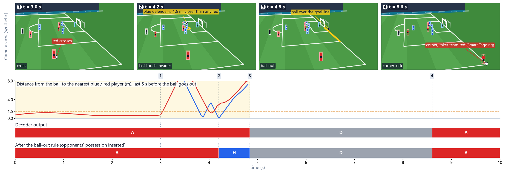

# Method figures

One figure per component of the final pipeline, in pipeline order. In each figure, frames 1–4 are camera views
rendered from **synthetic** player and ball positions (no match frames are shown or used). The rows below the
frames show the signal the component reads or produces, on the same time axis; the numbered markers give the time
of each frame. Blue = home (H), red = away (A), grey = dead ball (D). The numbers in the captions come from the
validation in the technical report (§4, §7). Regenerate with `python make_method_figures.py .`

**Figure 1. Ball fusion.** The tactical tracker loses the ball during a long pass (frames 2–3). The gap is filled
first with the broadcast-tracking ball, aligned to the tactical clock with one time offset per half (frame 2), and
then with our YOLO26s detection in the tactical video, used only when its track was anchored to the tracker ball
(frame 3). Every later stage uses the fused ball. Over the whole match this raises ball availability from 59% to
67% of graded frames.

**Figure 2. Dead-ball detector with boundary snapping.** After a tackle the ball crosses the touchline (frame 2).
Players slow down, nobody passes and the ball stays off the pitch (frame 3), so the dead-ball score rises and a
two-state Viterbi opens a `D` segment, but its boundaries follow the slow behavioural cues. Snapping moves its start to the moment
the ball crosses the line and its end to the restart kick or throw (frame 4). On IDSSE this raises dead-ball F1 from
0.933 to 0.948, and the share of `D` ends within 0.5 s from 44% to 93%.

**Figure 3. Possession model.** At every 10 fps step the model reads 47 features: the ball, the nearest players of
each team around it through a set encoder (frame 1), team shape (frame 2), and ball direction, speed and each team's
first arrival time at the ball (frame 3). Six sequence networks (BiGRU, TCN and two set-encoder variants) output H/A
log-odds, which are averaged. When red reaches the pass first, the mean drops below zero and stays there (frame 4).
External leave-match-out CV: spellF1 ≈ 0.81.

**Figure 4. Touch evidence from video.** In a duel the tracker loses the ball and the model alone keeps blue in
possession. In the video, a kink in the YOLO ball path together with contact between the ball and a player box
(frames t−3…t+3) marks a touch (frame 2). A kit-colour classifier on the toucher's crop says red (frame 3). Each
touch adds ±β log-odds to the toucher's team for at most 1 s (β = 4 tactical camera, 2 broadcast ball, 0.5 broadcast
candidate), enough to open the short red possession before blue wins the ball back (frame 4). Effect on spellF1:
+0.009 [+0.006; +0.012], better in 19/23 external matches (simulation).

**Figure 5. Three-state Viterbi decoder.** A pass travels past red and blue players without any touch. The nearest
player changes six times, and the sign of the per-step log-odds also flips. The decoder charges 10 (in ½ log-odds
units) for each change between H and A, and each dip is worth less than the two switches it would need, so the output
stays one blue possession. External CV: Viterbi ≈ 0.81 vs 0.68 for per-frame labels.

**Figure 6. Whistle rule.** A foul stops play without the ball leaving the pitch (frame 1). The dead-ball detector
only notices the stoppage once players have slowed down (frame 3). The audio of the tactical video carries a
two-tone whistle at the moment of the foul (frame 2): when a predicted `D` starts within 3 s after a whistle heard
during live play (score above 2.2), `D` is moved back to the whistle. At the restart, the tagged taker's team owns
the first 2 s (frame 4).

**Figure 7. Last touch before the ball goes out (Laws of the Game).** Red crosses (frame 1) and a blue defender heads
the ball over the goal line (frames 2–3). The decoder keeps red until the ball goes out. A corner is awarded to red
(frame 4), so by the Laws the last touch was blue's. When the label just before the ball goes out equals the
taker's team, the rule inserts the opponents' possession from their last touch: the nearest opponent within 1.5 m
of the ball and closer than any taker team player, in the last 5 s. On IDSSE: +0.0065 spellF1, better in 7/7
matches; 13 insertions in this match.
